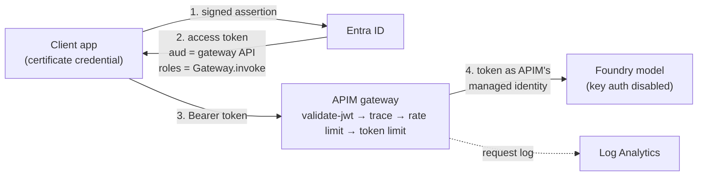
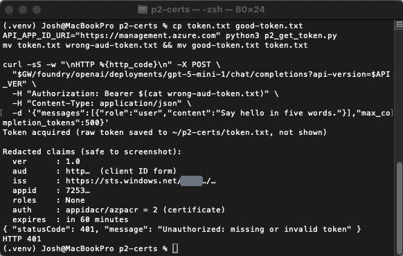
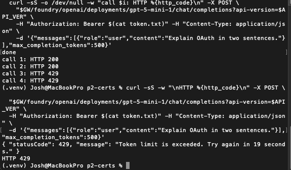
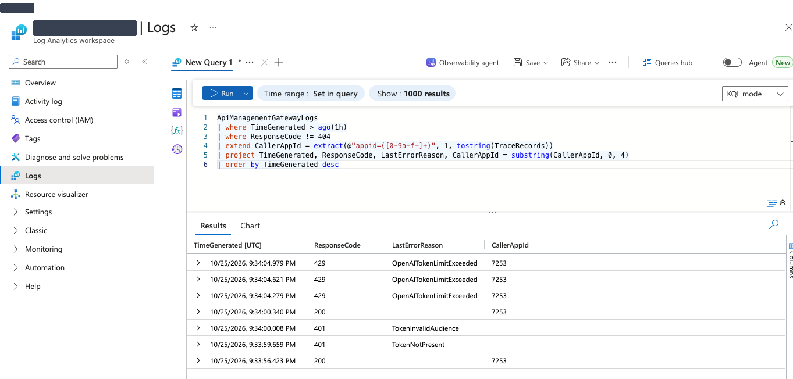

# Part 2: An AI gateway that knows who's calling

Part 1 ended with an attribution problem. The agent's tool reached storage as the shared Foundry resource identity, so working out which agent did what meant joining traces against storage logs.

Part 2 puts Azure API Management (APIM) in front of the model. Every caller has to show an Entra token for the gateway, every limit is tracked against that caller's identity, and the gateway reaches the model with its own managed identity. No keys anywhere.

## Architecture

Two identities, two hops. The client's certificate gets it through the gateway. APIM's managed identity gets the request to Foundry. Neither one ever holds the other's credential.

## Controls

The full inbound policy is in [`policies/foundry-model-inbound.xml`](../policies/foundry-model-inbound.xml). The token script and test runner are in [`scripts/`](../scripts/).

| Control | What it enforces | How |
|---|---|---|
| Certificate credential | The client app has no secret. It proves itself by signing with a private key that never leaves the machine | App registration with an uploaded public cert. The token shows `appidacr = 2` |
| App role | A valid token isn't enough. The caller must be granted `Gateway.invoke` | App role on the gateway API, application permission, admin consent |
| `validate-jwt` | Signature, expiry, audience, issuer, and the `roles` claim | APIM inbound policy, v1 issuer, `api://` audience |
| No subscription key | Removes a shared secret as a way in | "Subscription required" off on the API |
| Per-caller rate limit | 5 requests per minute per app | `rate-limit-by-key` keyed on the token's `appid` |
| Per-caller token limit | 300 model tokens per minute per app | `llm-token-limit` keyed on the token's `appid` |
| Keyless backend | Gateway reaches Foundry as itself | System-assigned managed identity with a role on the Foundry resource |
| Attributable logs | Every decision is logged with its reason, and allowed calls carry the verified app ID | Gateway logs to Log Analytics plus a `trace` policy after validation |

## Tests

| Test | Expected | Result | Evidence |
|---|---|---|---|
| Certificate token, correct audience and role | 200 | 200 | [P2-07-cert-token-200](../images/part2/P2-07-cert-token-200.png) |
| No token | 401 | 401 | [P2-08-no-token-401](../images/part2/P2-08-no-token-401.png) |
| Real token from the same app and cert, issued for Azure Resource Manager | 401 | 401 | [P2-08-wrong-aud-401](../images/part2/P2-08-wrong-aud-401.png) |
| Repeated calls over 300 tokens per minute | 429 | 200, 200, 429, 429 ("Token limit is exceeded. Try again in 19 seconds.") | [P2-09-token-limit-429](../images/part2/P2-09-token-limit-429.png) |
| Gateway logs | Each outcome recorded | 200 and 429 rows tagged with the caller's app ID; the two 401s logged with different reasons (token not present, invalid audience) | [P2-10-kql-denials](../images/part2/P2-10-kql-denials.png) |

The wrong-audience test matters most. That token was genuine: right tenant, valid signature, same certificate app. It was refused only because it was minted for a different API. That's the defense against a token stolen from one service being replayed against another.

**Wrong-audience token rejected**

**Token limit tripping**

**Gateway log: outcome, reason, and verified caller**

## Certificate vs. managed identity

| | Certificate | Managed identity |
|---|---|---|
| Use it when | The workload runs outside Azure | The workload runs on an Azure resource |
| You manage | A private key: storage, permissions, rotation | Nothing. Azure issues and rotates it |
| What can leak | The key file | No credential exists to leak |
| Lifecycle | Lives until you remove it | System-assigned: deleted with the resource |

Rule of thumb: use a managed identity whenever you can, a federated credential for CI outside Azure, a certificate for everything else, and never a client secret.

## Findings

1. **The caller gets the same 401 every time. The log records why.** Both rejected calls returned an identical "missing or invalid token" message. In Log Analytics, one is logged as `TokenNotPresent` and the other as `TokenInvalidAudience`, throttled calls show `OpenAITokenLimitExceeded`, and every allowed or throttled call carries the verified caller's app ID. The attacker learns nothing from the response; the defender sees the exact failure. That's the Part 1 attribution problem solved in one table instead of a cross-log join.
2. **The gateway can still be bypassed.** Foundry's endpoint is still public. Anyone with an Entra role on the Foundry resource can call it directly and skip every control here. Disabling key auth closed one bypass, not all of them. In production, a private endpoint and network rules on Foundry make the gateway the only way in.
3. **Reasoning models burn token budgets fast.** GPT-5 mini rejects `max_tokens` (it wants `max_completion_tokens`) and spends tokens reasoning before it answers. A 300-token-per-minute limit tripped after one or two short prompts. Token limits for reasoning models need different numbers than for chat models.
4. **API traffic wasn't logged until logging was turned on for the API itself.** The service-level diagnostic setting alone captured only unmatched requests. Those turned out to be 404s from internet scanners hitting the public gateway within days of creation.
5. **The import wizard isn't idempotent.** A failed run, from a rejected base path, still created the managed identity's role assignment on Foundry. The retry then failed because that role already existed.
6. **App role values are case-sensitive.** The role was created as `Gateway.invoke`, and the policy has to match that exactly.
7. **The wizard puts managed identity auth on the backend, not in the policy.** Reading only the policy XML, you'd miss how the gateway authenticates to Foundry.

## What this lab doesn't do (production gaps)

- The private key sits unencrypted on a laptop. In production it goes in Key Vault or an HSM with a short lifetime and automated rotation.
- The Foundry endpoint is public (finding 2).
- The Developer tier has no SLA.
- The limits are deliberately tiny so the tests trip quickly.

## Cost and teardown

APIM Developer tier, West US 3, $0.0658/hour. It ran from October 19 to October 25, about $10 total. Deleted on <!-- date -->. The app registrations and certificate are kept for now and will be removed after <!-- date -->.

## Screenshots

All screenshots are redacted: tenant ID, subscription ID, resource names, and email removed, with object IDs cut to 4 characters.

| File | Shows |
|---|---|
| [P2-01-apim-system-mi-on.png](../images/part2/P2-01-apim-system-mi-on.png) | APIM's system-assigned managed identity |
| [P2-02-gateway-api-app-role.png](../images/part2/P2-02-gateway-api-app-role.png) | `Gateway.invoke` app role, applications only |
| [P2-03-appreg-cert-no-secret.png](../images/part2/P2-03-appreg-cert-no-secret.png) | Client app: one certificate, zero secrets |
| [P2-03-client-app-role-granted.png](../images/part2/P2-03-client-app-role-granted.png) | Role granted with admin consent, no Graph permission |
| [P2-04-token-claims-cert.png](../images/part2/P2-04-token-claims-cert.png) | Token claims: `roles`, `appidacr = 2` |
| [P2-05-foundry-role-apim-mi.png](../images/part2/P2-05-foundry-role-apim-mi.png) | APIM's managed identity role on Foundry |
| [P2-06-validate-jwt-policy.png](../images/part2/P2-06-validate-jwt-policy.png) | The `validate-jwt` policy |
| [P2-07-cert-token-200.png](../images/part2/P2-07-cert-token-200.png) | Certificate token accepted |
| [P2-08-no-token-401.png](../images/part2/P2-08-no-token-401.png) | No token, denied |
| [P2-08-wrong-aud-401.png](../images/part2/P2-08-wrong-aud-401.png) | Wrong-audience token, denied |
| [P2-09-limits-policy.png](../images/part2/P2-09-limits-policy.png) | Rate and token limits keyed on `appid` |
| [P2-09-token-limit-429.png](../images/part2/P2-09-token-limit-429.png) | Token limit tripping |
| [P2-10-kql-denials.png](../images/part2/P2-10-kql-denials.png) | Gateway log: outcome, reason, caller |
